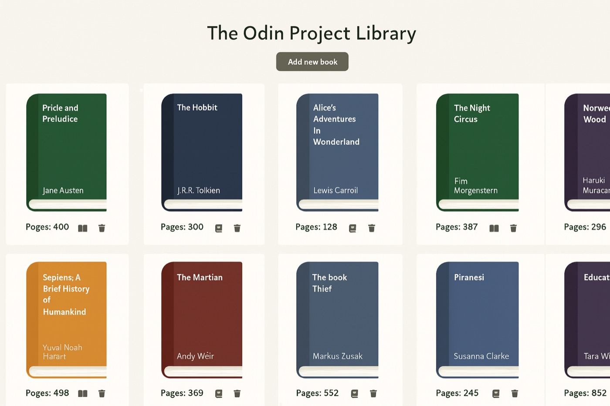

# Library

A personal book library: add books, mark them as read and remove them. Built with vanilla JavaScript for [The Odin Project](https://www.theodinproject.com/).

**▶ Live demo:** https://liza-uchaneva.github.io/Library_TheOdinProject/

## Features

- Add a book (title, author, pages, read status) through a modal `<dialog>` form
- Toggle read / unread, with the icon switching between a closed and an open book
- Remove books from the library
- Books are stored as `Book` objects (constructor + prototype) and re-rendered from that array

## Tech

HTML · CSS · vanilla JavaScript · Font Awesome

Open `index.html` in a browser. No build step.
